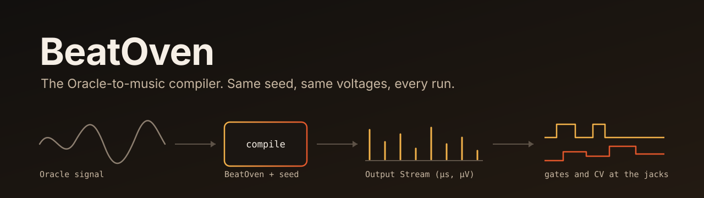

# BeatOven

<p align="center">
  
</p>

<p align="center">
  <a href="https://github.com/Zero-State-LLC/BeatOven/actions/workflows/test-output-module.yml"></a>
  <a href="https://github.com/Zero-State-LLC/BeatOven/releases"></a>
  <a href="pyproject.toml"></a>
  <a href="LICENSE"></a>
  <a href="specs/001-output-module/spec.md"></a>
  <a href="docs/handoff/NEXT.md"></a>
</p>

**BeatOven** is the Oracle-to-music compiler from [Zero State](https://github.com/Zero-State-LLC). It turns a symbolic signal from the Abraxas Oracle into music: MIDI, a session recipe, and an **Output Stream** that a Eurorack module can play. The same input and seed give byte-identical output.

BeatOven is not Beatoven.ai. That is an unrelated company.

## Status

| Part | State |
|---|---|
| Pack renderer (`render_pack`) | Works. Deterministic, with provenance hashes. |
| Output Stream, adapters, host driver | Works. Tested against a simulated device, including through the operating system's MIDI stack. |
| Driving real hardware | **Never done.** No Output Module has been built. Hardware control is off unless an operator supplies a grant file. |
| Older engine modules (rhythm, harmony, stems, media intelligence, mobile UI) | Present and partly tested. Not maintained in this pass. See the [2025 README](docs/archive/README-2025.md). |

The hardware lives in a separate repository, working name Kiln.

## Quick start

```bash
git clone https://github.com/Zero-State-LLC/BeatOven.git
cd BeatOven
python -m venv .venv && source .venv/bin/activate
pip install -e ".[dev,hardware]"
python -m pytest beatoven/output_module
```

Compile a BeatOven Pack to an Output Stream and check that two plays match:

```bash
python -m beatoven.output_module replay-check beatoven/output_module/vectors/stream.json
```

```text
stream_id=453ea6bc2cf8461cc57a35b6aaea3bbd6dd44f717cfc68cc7c27300a47feab89
run1=e15b1b3ebc6e524fd2fee5af13d0e79c315bcff357378bfdccdb9fd07f13e8ac
run2=e15b1b3ebc6e524fd2fee5af13d0e79c315bcff357378bfdccdb9fd07f13e8ac
identical=True
```

## How it works

1. **Compile.** An adapter turns a BeatOven Pack (or a `ResonanceFrame`, `AudioControlFrame`, `cv_gate_map` or `MIDIEventStream.v1`) into an Output Stream. Every event has a time in microseconds and a value in microvolts at the jack.
2. **Send ahead.** The host driver syncs clocks with the device and sends each event before it is due.
3. **Play on the device clock.** The device schedules events itself, so link jitter does not reach the jacks.
4. **Fail closed.** If timing is lost, gates and clock go low, CV goes to a safe value, and nothing resumes without a fresh sync.
5. **Prove it.** The device returns a hash of what it played. The simulated device also records a jack trace you can diff.

```python
from beatoven.engine.render import render_pack
from beatoven.output_module import (
    LoopbackTransport, OutputModuleDriver, SimulatedOutputModule, VirtualClock, from_pack,
)

pack = render_pack(oracle_signal, overlays={}, seed=7, daw="ableton")
stream = from_pack(pack, time_unit="beats")   # the unit is required; the Pack does not state it

clock = VirtualClock()
device = SimulatedOutputModule()
driver = OutputModuleDriver(LoopbackTransport(device, clock), clock)
driver.connect()
report = driver.play(stream)
print(report.ok, device.trace_hash())
```

## Command line

| Command | What it does |
|---|---|
| `python -m beatoven.output_module compile PACK --time-unit beats` | Pack JSON to Output Stream JSON |
| `... simulate STREAM` | Play on the simulated device and print the jack trace |
| `... replay-check STREAM` | Play twice on separately clocked devices and compare |
| `... ports` | List MIDI ports (needs `pip install -e ".[hardware-midi]"`) |
| `... send STREAM --out NAME --in NAME --grant FILE` | Play to a real MIDI port. Refuses without a grant file |

## Documentation

| Read this | For |
|---|---|
| [specs/001-output-module/spec.md](specs/001-output-module/spec.md) | What the Output Module must do, the connection lifecycle, open questions |
| [specs/001-output-module/plan.md](specs/001-output-module/plan.md) | The Output Stream contract, wire format, migration from the older contracts |
| [specs/001-output-module/audit.md](specs/001-output-module/audit.md) | What was wrong before, with evidence |
| [docs/adr/](docs/adr/) | Decisions and proposals |
| [GLOSSARY.md](GLOSSARY.md) | The words this project uses |
| [docs/handoff/NEXT.md](docs/handoff/NEXT.md) | Current state and what is next |
| [CHANGELOG.md](CHANGELOG.md) | What changed in each version |

## Project rules

- **SEED determinism.** Identical inputs give identical bytes.
- **Fail closed.** A bad packet, a missing grant or lost timing ends in a safe state.
- **Unknown stays unknown.** A missing unit or meaning is never guessed.
- **PsyFi owns visualization.** BeatOven does not render visuals.
- **Public shapes change by proposal.** See [CONTRIBUTING.md](CONTRIBUTING.md).

The full list is in the [constitution](.specify/memory/constitution.md) (draft).

## Contributing and security

See [CONTRIBUTING.md](CONTRIBUTING.md). Report vulnerabilities as described in [SECURITY.md](SECURITY.md).

## License

Apache 2.0. See [LICENSE](LICENSE) and [NOTICE](NOTICE).
