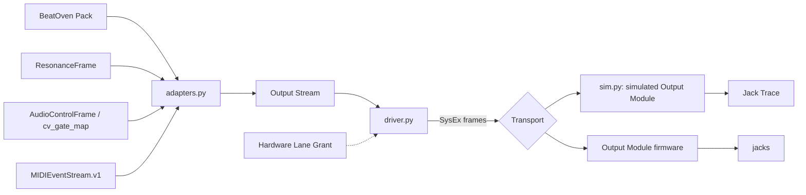

# Plan: 001 Output Module

Status: software implemented on branch `feat/output-module-contract`; hardware in the separate repo (working name Kiln). Labels as in `spec.md`.

## Stack

| Part | Choice | Reason |
|---|---|---|
| Host code | Python ≥ 3.9, standard library plus `cbor2` (already the `hardware` extra) | Same language as the rest of the repo. Integer and `Decimal` math only, so results do not vary by platform. |
| Host tests | pytest | Already the repo's runner. |
| Host link, primary | USB-MIDI 1.0, class compliant, Output Stream in System Exclusive | [research/transport-tradeoffs.md](research/transport-tradeoffs.md) |
| Host link, fallback | TRS MIDI in, Type A, same bytes | Same file. One-way. |
| Real MIDI port on the host | `python-rtmidi` or `mido`, optional extra, not yet wired (task 001-T056) | Needs a device to test against. |
| MCU | RP2350A on a new board | About US$1.2 at qty 10 against about US$40 for a Daisy Patch SM, which has only two 12-bit CV outputs [OBSERVED: research/transport-facts.md §2.2, §2.3]. Production to at least 2045 [OBSERVED: §2]. |
| DAC | TI DAC80508, 8 channels, 16 bit | One part covers 2 pitch and 6 mod CV. See the hardware repo. |
| Firmware | C11 core with no SDK dependency, plus pico-sdk and TinyUSB | The core is tested on a desktop against golden vectors from this repo. |

## Architecture



Files, all under `beatoven/output_module/`:

| File | Role |
|---|---|
| `contract.py` | Output Stream, Output Event, Output Channel, Descriptor, quantization rule |
| `adapters.py` | One pure function per existing contract |
| `wire.py` | SysEx frame, 7-bit packing, CRC-16, message types |
| `lifecycle.py` | The transitions table; exported to `beatoven/schemas/beatoven.output_module_lifecycle.v1.json` |
| `authority.py` | Hardware Lane Grant; deny by default |
| `driver.py` | Host driver: enumerate, sync, feed ahead, compare played hash |
| `sim.py` | Simulated Output Module and Jack Trace |
| `__main__.py` | `compile`, `simulate`, `replay-check`, `vectors` |
| `vectors/` | Golden vectors the firmware is tested against |

## Canonical hardware contract

Schema: `beatoven/schemas/beatoven.output_stream.v1.schema.json`. Identifier: `beatoven.output_stream.v1`.

```json
{
  "schema": "beatoven.output_stream.v1",
  "stream_id": "sha256:<hex of canonical bytes>",
  "source": {"contract": "beatoven.pack.v0", "hash": "<sha256>", "seed": 7},
  "clock_pulse_us": 5000,
  "duration_us": 1823708,
  "notes": ["UNROUTED: ...", "NOT_COMPUTABLE: ..."],
  "events": [{"t_us": 0, "ch": "PITCH_CV:0", "op": "SET_UV", "value": 3000000}]
}
```

| Field | Unit / values | Rule |
|---|---|---|
| `t_us` | microseconds from stream start, 0 to 2^40 − 1 | Integer. Events sorted by (time, channel, op, value); duplicates refused. |
| `ch` | `PITCH_CV:n`, `MOD_CV:n`, `GATE:n`, `CLOCK:n`, `RESET:n`, n 0–15 | Wire id = kind base (0x00, 0x10, 0x20, 0x30, 0x40) + n. |
| `SET_UV` | microvolts at the jack, int32 | Pitch and mod CV only. Pitch is 1 V/oct: (note − zero-volt note) × 1 000 000 / 12, rounded half to even. |
| `GATE_ON`, `GATE_OFF` | value 0 | Gate channels only. |
| `PULSE` | width in microseconds, 1 000 to 10 000 000 | Gate, clock and reset channels. |
| `CLOCK_PERIOD` | period in microseconds, ≥ 1 000; 0 stops | Clock channel. The device generates pulses of `clock_pulse_us`, capped at half the period. |
| `stream_id` | SHA-256 of header fields joined by `\|`, a newline, then each event as 14 bytes big-endian (`u64 t_us, u8 op, u8 channel, i32 value`) | Recomputed on load; mismatch is refused. |

The Descriptor (`beatoven.output_module_descriptor.v1`) lists each channel's `min_uv`, `max_uv`, `bits`, `safe_policy` (`HOLD` or `SLEW_TO_SAFE`) and `safe_uv`, plus `queue_capacity`, `max_events_per_frame`, `min_lead_us`, `keepalive_timeout_us`, `sync_timeout_us`, `safe_slew_us`.

PROPOSED reference channel set: 2 `PITCH_CV` (0 to +10 V, 16 bit, hold), 6 `MOD_CV` (−5 to +5 V, 16 bit, slew to 0 V), 4 `GATE`, 1 `CLOCK`, 1 `RESET`.

### Wire

```
F0 7D 'B' 'O' <proto=1> <type> <seq> <7-bit packed (body + CRC-16/CCITT-FALSE)> F7
```

| Type | Dir | Body |
|---|---|---|
| `HELLO` 0x01 | host → device | empty |
| `SYNC` 0x02 | → | `u64` host time, µs |
| `STREAM_BEGIN` 0x03 | → | 32-byte stream id, `u32` event count, `u64` start in device time, `u32` clock pulse µs |
| `EVENTS` 0x04 | → | `u32` first index, `u8` count, count × 14-byte records |
| `ABORT` 0x05 | → | empty |
| `STREAM_BEGIN_REL` 0x07 | → | as `STREAM_BEGIN`, but the `u64` is a lead time in µs from receipt. For links with no return path |
| `OPS` 0x06 | → | CBOR `{kind, nonce, payload}` (the Ops lane map, unchanged) |
| `DESCRIPTOR` 0x41 | ← | CBOR Descriptor |
| `SYNC_ACK` 0x42 | ← | echoed host time, `u64` device time |
| `ACK` 0x43 | ← | acked seq, ok |
| `STATUS` 0x44 | ← | state, loss reason, `u32` played |
| `OPS_ACK` 0x45 | ← | CBOR `{ack, ok}` |
| `STREAM_DONE` 0x46 | ← | first 8 bytes of stream id, `u32` played, SHA-256 of played records |

### Clock sync and jitter budget

1. The host sends `SYNC` with its monotonic time. The device answers with its own time. Offset = device time − host send time − round trip ÷ 2.
2. `STREAM_BEGIN` names the start in device time. From then on the device's clock alone decides when each event plays.
3. The host sends each event when it is within the look-ahead (default 50 ms) of its due time. The device needs it at least `min_lead_us` (default 5 ms) before the stream starts.
4. Budget [INFERRED; to be confirmed by HT-2 and HT-4]: link arrival jitter up to about 1.4 ms [OBSERVED: research/transport-facts.md §1.2] is absorbed by the 50 ms look-ahead. Jitter at the jack is then the device timer resolution plus DAC write time, targeted at ≤ 100 µs RMS.
5. Sync error shifts the whole stream by a constant; it does not add jitter between events.

### Timing loss, defined

`fail_closed_on_timing_loss` now means: on any of `LATE_EVENT`, `SEQUENCE_GAP`, `INTEGRITY`, `KEEPALIVE_TIMEOUT` (500 ms without a frame while events are outstanding), `SYNC_TIMEOUT` (2 s without a sync while idle), `QUEUE_OVERFLOW` or `HOST_ABORT`, the device drops its queue, sets gates, clock and reset low at once, and takes each CV channel to its Safe Value by its policy. It then reports `SAFE_IDLE` and waits for a fresh sync.

## Migration table

No existing name or shape is edited. Each row is either an adapter (done) or a proposal (not done).

| Existing contract | Becomes | How | Change to the existing contract |
|---|---|---|---|
| BeatOven Pack v0 `midi.tracks` | pitch, gate and trigger events | `from_pack` with a stated `time_unit`; roles routed DRUMS → `GATE:0` triggers, BASS → `PITCH_CV:0` + `GATE:1`, MELODY → `PITCH_CV:1` + `GATE:2`, HARMONY → `GATE:3`; `cc_lanes` → `MOD_CV:0–3` at 0 to +5 V | None |
| Pack v0 `cv` | `CLOCK_PERIOD` from `clock_hz`; `MOD_CV` lane → `MOD_CV:4`; CLOCK lane points reported `NOT_COMPUTABLE` | `from_pack` | None. **Proposal, version bump to `beatoven.pack.v1`:** state the unit of `t`; derive `clock_hz` from `tempo_bpm`; emit typed `PITCH_CV`, `GATE`, `TRIGGER`, `RESET` lanes or drop `cv` in favour of an embedded Output Stream. v0 stays readable. |
| `ResonanceFrame`, `ResonanceMetrics`, `RhythmTokens` | six metrics → `MOD_CV:0–5`; step grids → triggers on `GATE:0–3`; `bpm` → clock | `from_resonance_frame` with a stated `step_threshold` | None. **Proposal:** make `ResonanceFrame.new` take `id` and `ts_ms` as required arguments so two runs match (today they default to wall-clock time). |
| Realtime lane `/macro`, `/meta` | Not carried. Same information arrives as `SET_UV` and `CLOCK_PERIOD` | n/a | None. Stays for DPT use. |
| Ops lane (u32 length + CBOR, nonce ACK) | `OPS` / `OPS_ACK` messages; same CBOR map, same kind literals | `OutputModuleDriver.ops` | None to the map or literals. Framing differs on this link only; `SerialOpsLane` is untouched. |
| `PresetBank`, `PresetRegistry`, `BridgeRuntime`, Actions | Not used by the Output Module. They choose presets on a DSP device; the Output Module has no presets | n/a | None |
| `AudioControlFrame`, `BEATOVEN_CONTRACT` | tempo → clock; five fields → `MOD_CV:0–4` | `from_audio_control_frames` with a stated `window_us` | None |
| `BeatOvenOverlay` `cv_gate_map` | clock + triggers on `GATE:0` | `from_cv_gate_map` | None |
| `MIDIEventStream.v1` | notes → pitch, gate, trigger; CC → mod CV | `from_midi_event_stream` | None to the names. **Proposal for canon:** define the event item as `{"t": int, "status": int, "data1": int, "data2": int}` and give `command_rate_budget` a unit. The adapter reads this PROPOSED shape. |
| `MIDIClipIR.v1`, `OraclePacket.v1`, `BeatOvenRun.v1` | No adapter | Canon does not define them enough to read | None. See open clarifications 4 and 5. |

## Firmware architecture

In the hardware repo. Five parts, mirroring `sim.py`:

1. **Transport parser.** Reassembles SysEx from USB-MIDI packets or the TRS UART, unpacks 7-bit, checks the CRC, dispatches by type.
2. **Event scheduler.** A fixed-capacity queue ordered by (time, priority, arrival). At equal time: internal falling edges, then stream events, then clock ticks. A hardware timer alarm fires at the next due time.
3. **DAC and gate driver.** `SET_UV` → calibrated 16-bit code → DAC80508 over SPI; gates on GPIO.
4. **Calibration store.** Per-channel gain and offset in flash, applied after the quantization rule.
5. **Lifecycle.** The same table as `lifecycle.py`, generated from or checked against the exported JSON.

Deterministic replay: the firmware core, compiled on a desktop, must reproduce `vectors/expected_trace.csv` byte for byte from `vectors/host_frames.hex`. On hardware, HT-6 diffs logic-analyzer captures against the same file.

## Host-side driver

`OutputModuleDriver(transport, clock, grant)`:

- `connect()`: checks the Hardware Lane, sends `HELLO`, validates the Descriptor and contract version, syncs. Ends in `SYNCED` or `SAFE_IDLE` with `reject_reason`.
- `play(stream)`: checks the stream against the Descriptor, sends `STREAM_BEGIN`, feeds events within the look-ahead, keeps syncing every 250 ms, and returns a `PlayReport` with the played-hash comparison or the loss reason.
- `resync()`: the only way out of `SAFE_IDLE`.
- `ops(kind, payload)`: the Ops lane.

The clock and transport are injected, so tests run on a virtual clock with no sleeping.

## Test strategy

| Level | What | Where | State |
|---|---|---|---|
| Contract and adapters | AT-001 to AT-011, AT-022 | `beatoven/output_module/tests/` | Passing |
| Wire and Ops lane | AT-012, AT-013 | same | Passing |
| Lifecycle and fail-closed, with fault injection | AT-014 to AT-021 | same | Passing in simulation |
| Firmware core against golden vectors | byte-exact Jack Trace | hardware repo `firmware/core/test/` | See that repo |
| Bench | HT-1 to HT-6 | hardware repo `docs/test-plan.md` | Plan only |

The simulated Output Module is a model of ideal hardware. Passing in simulation proves the protocol and the logic. It proves nothing about latency, jitter, voltage accuracy or electrical survival.

## Stateful behavior

Carried forward unchanged from `spec.md`. Initial state `DISCONNECTED`; final state `DISCONNECTED`.

| from | event | guard | to | effect |
|---|---|---|---|---|
| `DISCONNECTED` | attach | transport link is up | `ENUMERATING` | drive all outputs safe; exchange the Descriptor |
| `ENUMERATING` | sync_ok | Descriptor accepted, contract version matches, Hardware Lane granted | `SYNCED` | record the clock offset |
| `ENUMERATING` | reject | Descriptor invalid, version mismatch, or Hardware Lane denied | `SAFE_IDLE` | outputs stay safe; report the reason |
| `ENUMERATING` | detach | transport link is down | `DISCONNECTED` | drive all outputs safe |
| `SYNCED` | stream_begin | stream fits the Descriptor and starts at least min lead in the future | `STREAMING` | arm the scheduler |
| `SYNCED` | timing_loss | no sync within the sync timeout | `TIMING_LOST` | apply fail-closed outputs |
| `SYNCED` | detach | transport link is down | `DISCONNECTED` | drive all outputs safe |
| `STREAMING` | stream_end | every event has played | `SYNCED` | gates low, clock stopped, CV held; report the played hash |
| `STREAMING` | timing_loss | late event, sequence gap, integrity failure, keepalive timeout, overflow or host abort | `TIMING_LOST` | drop the queue; apply fail-closed outputs |
| `STREAMING` | detach | transport link is down | `DISCONNECTED` | drive all outputs safe |
| `TIMING_LOST` | safe_reached | every output is at its Safe Value | `SAFE_IDLE` | report status |
| `TIMING_LOST` | detach | transport link is down | `DISCONNECTED` | drive all outputs safe |
| `SAFE_IDLE` | resync | a fresh sync exchange succeeded | `SYNCED` | record the clock offset |
| `SAFE_IDLE` | detach | transport link is down | `DISCONNECTED` | drive all outputs safe |

Illegal transitions: every pair not listed (40). See `spec.md`.

## Workflows

Carried forward unchanged from `spec.md`.

- Governing workflows (skills): `anti-slop-code`, `production-systems`, `google-developer-style`.
- Owners: **FORGE** decomposes. A **cloud agent** implements. **SCRIBE** files the compact artifact. **ADVERSARY** reviews against the transitions table and the fail-closed criteria.

## Known limits of this implementation

- The driver has no real MIDI port transport yet (001-T056). Everything has run only against the simulated device.
- `SLEW_TO_SAFE` is recorded in the Jack Trace as one entry, not as a ramp of samples.
- The simulated device answers `PING` only; other Ops kinds return not-ok.
- One-way mode (`play_one_way`, `STREAM_BEGIN_REL`) is implemented and tested on a simulated 31.25 kbaud line. Defaults: 1 s lead, 750 ms look-ahead, 4 events per frame. The host does not pre-check that the link can carry the stream; a stream that is too dense fails closed on the device.
- After a one-way stream ends, the device times out to `SAFE_IDLE` within the sync timeout unless the host keeps sending sync messages. The next run re-syncs it.
- The plain play-on-arrival MIDI mode (journey 5 in the concept) is not implemented.
