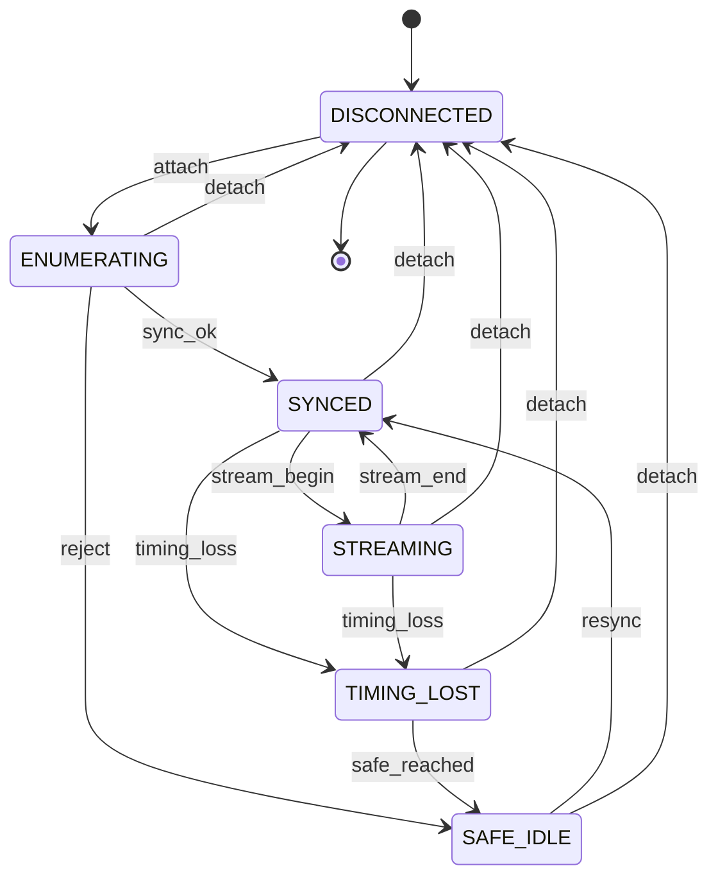

# 001: Output Module

Status: DRAFT (2026-11-11). The software requirements (FR-001 to FR-018) are implemented on this branch and pass their acceptance tests in simulation. The physical requirements (FR-019 to FR-025) have no hardware yet; their tests are plans.

Labels: `[OBSERVED: source]`, `[INFERRED]`, `[SPECULATIVE]`. Sources: [audit.md](audit.md), [research/](research/), the BeatOven Constitution (`constitution`).

"Output Module" is a PROPOSED name. Terms are defined in `GLOSSARY.md`.

## Summary

BeatOven compiles Abraxas Oracle output into music, but nothing it emits can be played by a device: four contracts overlap, none carries a voltage, and none says what happens when timing fails. [OBSERVED: audit.md rows 2, 3, 5]

This feature defines one Output Stream that a device can play exactly, the rules for turning each existing contract into it, the lifecycle of a connection to an Output Module, and the Output Module itself: a Eurorack Module that plays the Output Stream from its jacks.

The goal is that the same BeatOvenRun.v1 produces the same voltages at the same times on every run, and that a failure of timing produces silence rather than wrong notes. [OBSERVED: constitution principles 1, 2, 4]

## Scope

In scope:

- One canonical Output Stream with explicit units.
- Conversion of the BeatOven Pack, ResonanceFrame, AudioControlFrame, cv_gate_map and MIDIEventStream.v1 into an Output Stream.
- The connection lifecycle between a host and an Output Module.
- A simulated Output Module, so a run can be rehearsed and replayed without hardware.
- The Hardware Lane and its grant.
- The physical Output Module: its Output Channels, electrical limits and timing limits.

## Non-goals

- Audio output or synthesis.
- Visualization. PsyFi owns it. [OBSERVED: constitution principle 3]
- Composing on the device. The Output Module plays; BeatOven composes.
- Changing any existing public name or shape. Changes are proposals in `plan.md`. [OBSERVED: constitution principle 8]
- Wireless links.
- Driving the dsp.coffee DPT. Its bridge types stay as they are.

## User stories

### P1: Play a BeatOven Pack on a Rig, the same way every time

As a generative producer, I want my Rig to play what BeatOven composed, and to play it identically when I run the same seed again, so that I can re-record a take.

Independent test: compile one BeatOven Pack to an Output Stream, play it twice on two separately clocked simulated Output Modules, and compare the Jack Traces. No hardware and no other story is needed.

Acceptance criteria:

1. **Given** the same BeatOven Pack and seed, **when** it is compiled twice, **then** both Output Streams are byte-identical and have the same identifier. (AT-001)
2. **Given** an Output Stream, **when** any Output Event is read, **then** its time is in microseconds, its voltage is in microvolts at the jack, and a MIDI note one octave higher is exactly 1 000 000 µV higher. (AT-002)
3. **Given** an Output Stream saved and loaded, **when** one time value has been altered, **then** loading is refused. (AT-003)
4. **Given** an Output Event with a pulse shorter than 1 ms, a negative time, or an operation its Output Channel does not support, **when** the stream is built, **then** it is refused. (AT-004)
5. **Given** an Output Stream, **when** it is written out, **then** it validates against the published schema. (AT-005)
6. **Given** a BeatOven Pack, **when** it is compiled without a stated time unit, **then** compilation is refused; **and** every input that cannot be mapped is listed as `UNROUTED` or `NOT_COMPUTABLE`. (AT-006)
7. **Given** two notes that overlap on one pitch Output Channel, **when** compiled, **then** the first gate ends 1 ms before the second begins. (AT-011)
8. **Given** a synced Output Module, **when** an Output Stream is played to its end, **then** the lifecycle returns to `SYNCED`, the Output Module reports a hash equal to the stream's, and every gate and the clock are low. (AT-015, AT-017)
9. **Given** the same Output Stream played on two Output Modules whose clocks started at different values, **when** the Jack Traces are compared relative to stream start, **then** they are identical. (AT-016)
10. **Given** an Output Stream that asks for a voltage outside what the Descriptor allows, **when** play is requested, **then** it is refused before anything is sent and the lifecycle stays `SYNCED`. (AT-020)
11. **Given** any pitch from C0 to C5, **when** it is quantized for a 16-bit Output Channel, **then** the result is within half a step of the request. (AT-022)

### P2: Fail closed when timing is lost

As an installation artist, I want every gate to drop and the clock to stop the moment the host can no longer keep time, and nothing to restart by itself, so that an unattended Rig never plays wrong notes.

Independent test: play a stream on the simulated Output Module while dropping, delaying or withholding messages, and read the lifecycle and the Jack Trace.

Acceptance criteria:

1. **Given** a playing stream, **when** a message is lost, arrives after its events are due, or stops arriving, **then** the lifecycle goes `STREAMING → TIMING_LOST → SAFE_IDLE`, the reason is reported, every gate and the clock are low, and no Output Event plays afterwards. (AT-018)
2. **Given** `SAFE_IDLE` after Timing Loss, **when** play is requested without a fresh sync, **then** it is refused; **when** a fresh sync succeeds, **then** play works. (AT-019)
3. **Given** every state and every event, **when** an event not in the transitions table is fired, **then** it is refused. (AT-014)
4. **Given** no Hardware Lane Grant, **when** a host tries to connect to a physical Output Module, **then** the connection is rejected to `SAFE_IDLE` and nothing is sent to the device. **Given** a grant whose scope does not name the Output Module, **then** it is refused. (AT-021)

### P3: Bring every existing contract to the same Output Stream

As a BeatOven maintainer, I want each existing contract to compile into the Output Stream without being changed, so that upstream code keeps working.

Independent test: feed one sample of each existing contract through its adapter and check the resulting Output Events.

Acceptance criteria:

1. **Given** a BeatOven Pack, **when** it is compiled, **then** the Pack is unmodified and still validates against its own schema. (AT-007)
2. **Given** a ResonanceFrame with rhythm steps, **when** it is compiled without a step threshold, **then** it is refused; **with** one, steps at or above it become triggers, metrics become voltages, and unrouted metrics are listed. (AT-008)
3. **Given** AudioControlFrames, **when** compiled without a window length, **then** it is refused; **with** one, each frame sets the clock rate and five voltages. **Given** a cv_gate_map, **then** each `1` becomes a trigger and any other character is refused. (AT-009)
4. **Given** a MIDIEventStream.v1 in tick time, **when** compiled without resolution and tempo, **then** it is refused; **with** them, notes become pitch, gate and trigger events. (AT-010)
5. **Given** a frame on the host link, **when** one bit is flipped, **then** it is rejected; **and** every byte between the frame markers is below 128. (AT-012)
6. **Given** an Ops lane kind, **when** it is sent to an Output Module, **then** it arrives as the same `kind`, `nonce`, `payload` map and is acknowledged by nonce. (AT-013)

### P1-HW: The physical Output Module meets its limits

As a Eurorack performer, I want the Module to fit a skiff, stay within its power budget, track pitch, and survive patching mistakes.

Independent test: the bench plan in the hardware repo (`docs/test-plan.md`), tests HT-1 to HT-6. **Plan only: no hardware exists.**

Acceptance criteria:

1. **Given** a powered Module, **when** rail current is measured, **then** +12 V ≤ 120 mA and −12 V ≤ 50 mA; **and** a reversed power cable does no damage. (HT-1)
2. **Given** a trigger, **when** its width is measured, **then** it is ≥ 1 ms and equal to the requested width; **and** over ≥ 10 000 clock edges, jitter is ≤ 100 µs RMS against the host clock, or ≤ 50 µs when following the clock input. (HT-2)
3. **Given** calibration, **when** C0 to C5 is measured at 13 points, **then** error is within ±1 cent per octave. (HT-3)
4. **Given** a host send time, **when** the jack edge is measured, **then** each event is within 100 µs RMS of its scheduled time. (HT-4)
5. **Given** any output shorted to +12 V, −12 V or ground indefinitely, or a cable hot-plugged, **then** nothing is damaged. (HT-5)
6. **Given** the same BeatOvenRun.v1 sent twice, **when** logic-analyzer captures are diffed, **then** they are identical and match the simulated Jack Trace. (HT-6)

## Functional requirements

| ID | Requirement | Acceptance |
|---|---|---|
| FR-001 | The Output Stream MUST carry time in microseconds, voltage in microvolts at the jack, and widths in microseconds. No value is unitless. | AT-002, AT-005 |
| FR-002 | An Output Stream MUST be content-addressed: identical inputs give identical bytes and identifier; an altered stream is refused. | AT-001, AT-003 |
| FR-003 | An Output Event that is out of range, or not supported by its Output Channel, MUST be refused. Pulses MUST be ≥ 1 ms. The Output Module MUST make this check itself and treat a failure as Timing Loss; a malformed message MUST be refused without effect. | AT-004, AT-023, AT-024 |
| FR-004 | An Output Module MUST state its Output Channels and their ranges in a Descriptor. A stream outside the Descriptor MUST be refused before sending. | AT-020, AT-022 |
| FR-005 | The Pack adapter MUST require a stated time unit, MUST resolve overlapping notes by a fixed rule, and MUST list every input it cannot map. | AT-006, AT-011 |
| FR-006 | No adapter may modify its source or change an existing public shape. | AT-007 |
| FR-007 | The ResonanceFrame adapter MUST require a stated step threshold. | AT-008 |
| FR-008 | The AudioControlFrame adapter MUST require a stated window length; the cv_gate_map adapter MUST refuse an unknown pattern character. | AT-009 |
| FR-009 | The MIDIEventStream.v1 adapter MUST require resolution and tempo for tick time. | AT-010 |
| FR-010 | Every frame on the host link MUST be integrity-checked and MUST use only byte values below 128 between its markers. | AT-012 |
| FR-011 | Ops lane kinds, nonce and acknowledgement MUST be carried unchanged in meaning. | AT-013 |
| FR-012 | The connection MUST follow the transitions table. Any other transition MUST be refused. | AT-014, AT-015 |
| FR-013 | The Output Module MUST play each Output Event at its stated time on its own clock, independent of when the event arrived and of the clock's starting value. The host MUST keep following the Output Module's clock while a stream plays. | AT-016, AT-029 |
| FR-014 | On Timing Loss the Output Module MUST, at once, set gates, clock and reset low, discard queued events, and take each CV Output Channel to its Safe Value by its stated policy (hold, or slew). | AT-017, AT-018 |
| FR-015 | Play MUST NOT resume after Timing Loss without a fresh sync requested by the host. | AT-019 |
| FR-016 | At stream end the Output Module MUST report a hash of the events it played. | AT-015 |
| FR-017 | The Hardware Lane MUST be closed by default. Only a Hardware Lane Grant that names the Output Module scope opens it. | AT-021, AT-027 |
| FR-018 | A simulated Output Module MUST produce a Jack Trace for any Output Stream, with no grant. | AT-016 |
| FR-026 | On a link with no return path the Output Module MUST still schedule every event from a start it derives on receipt, and the host MUST report the run as unconfirmed. A link too slow for the stream MUST end in Timing Loss, not late notes. | AT-025, AT-026 |
| FR-027 | The host MUST be able to play an Output Stream through the operating system's own MIDI ports, with the same Jack Trace as in simulation. | AT-028 |
| FR-028 | The host MUST be able to read, write and revert an Output Module's calibration record over the Ops Lane, only while `SYNCED`. A write MUST be validated against the Descriptor and stated bounds and stored all or nothing. Calibration MUST NOT change the Output Stream, the played hash or the Jack Trace. (ADR 0006) | AT-030, AT-031 |
| FR-029 | Changing calibration on real hardware MUST need a Hardware Lane Grant that names the `output_module.calibrate` scope and states an expiry. That scope MUST NOT open play, and the play scope MUST NOT permit changing calibration. (ADR 0006) | AT-032 |
| FR-030 | An Output Module with a CLOCK IN jack MUST report the measured period to the host and MUST NOT change playout because of it. A host MUST ignore device messages and Descriptor fields it does not know. (ADR 0005) | AT-033, AT-034 |
| FR-019 | The Module MUST be 3U (128.5 mm panel) and 12 HP, and ≤ 40 mm deep behind the panel. | HT-1 (inspection) |
| FR-020 | The Module MUST draw ≤ 120 mA from +12 V and ≤ 50 mA from −12 V, and MUST survive reversed power. | HT-1 |
| FR-021 | The Module MUST provide ≥ 1 pitch output at 1 V/oct, ±1 cent per octave over 5 octaves after calibration, with static error within ±0.5 mV at every calibration point and a 1 V step within 1 cent (833 µV) inside 200 µs, measured at the jack (operator decision C5); ≥ 4 CV outputs; ≥ 4 gate/trigger outputs; 1 clock and 1 reset output. | HT-2, HT-3 |
| FR-022 | Playout error MUST be ≤ 100 µs RMS: each event leaves the jack within that of its scheduled time. The host MUST send each event at least 5 ms ahead. (Restated from "≤ 2 ms p99 from host send to jack", which scheduled playout cannot meet by design; operator decision C6.) | HT-4 |
| FR-023 | Clock jitter MUST be ≤ 100 µs RMS against the host clock, ≤ 50 µs following the clock input. | HT-2 |
| FR-024 | Every output MUST survive an indefinite short to +12 V, −12 V or ground. | HT-5 |
| FR-025 | Identical Output Streams MUST produce identical logic-analyzer captures. | HT-6 |

## Success criteria

| ID | Criterion | Measured by | State |
|---|---|---|---|
| SC-001 | 100% of replays of one Output Stream give an identical Jack Trace in simulation. | AT-016, `replay-check` | Met [OBSERVED: test run on this branch] |
| SC-002 | 0 Output Events play after Timing Loss. | AT-018 | Met in simulation [OBSERVED] |
| SC-003 | 4 of 4 existing contracts compile to an Output Stream with 0 changes to their schemas. | AT-006 to AT-010, AT-007 | Met [OBSERVED] |
| SC-004 | 0 connections to a physical device succeed without a grant. | AT-021 | Met [OBSERVED] |
| SC-005 | Playout error ≤ 100 µs RMS; clock jitter ≤ 100 µs RMS. | HT-2, HT-4 | Plan only |
| SC-006 | Pitch error ≤ ±1 cent per octave, C0–C5. | HT-3 | Plan only |
| SC-007 | Two hardware replays give identical captures. | HT-6 | Plan only |

## Domain entities

- **Output Stream**: events, source contract, source hash, seed, clock pulse width, notes, identifier.
- **Output Event**: time, Output Channel, operation, value.
- **Output Channel**: kind (pitch CV, mod CV, gate, clock, reset) and number.
- **Descriptor**: device, firmware, Output Channels with range, resolution and Safe Value policy, queue size, timeouts.
- **Jack Trace**: time, jack, kind of change, value.
- **Hardware Lane Grant**: who granted, when, scope, expiry.
- **Connection**: lifecycle state, clock offset, loss reason.

## Stateful behavior

One lifecycle: the connection between a host and an Output Module. The host and the Output Module each hold a copy; the Output Module's copy is authoritative.

Initial state: `DISCONNECTED`. Final state: `DISCONNECTED`. `SAFE_IDLE` is the resting state after any rejection or Timing Loss.

### States

| State | Meaning |
|---|---|
| `DISCONNECTED` | No link. Outputs are at Safe Values. |
| `ENUMERATING` | Link is up. The Descriptor is being exchanged and the first sync is in progress. |
| `SYNCED` | Descriptor accepted, clock offset known. Ready to play. |
| `STREAMING` | An Output Stream is playing. |
| `TIMING_LOST` | Timing was lost. Outputs are moving to Safe Values. |
| `SAFE_IDLE` | Outputs are at Safe Values. Nothing plays until a fresh sync. |

### Transitions

| from | event | guard | to | effect |
|---|---|---|---|---|
| `DISCONNECTED` | attach | transport link is up | `ENUMERATING` | drive all outputs safe; exchange the Descriptor |
| `ENUMERATING` | sync_ok | Descriptor accepted, contract version matches, Hardware Lane granted | `SYNCED` | record the clock offset |
| `ENUMERATING` | reject | Descriptor invalid, version mismatch, or Hardware Lane denied | `SAFE_IDLE` | outputs stay safe; report the reason |
| `ENUMERATING` | detach | transport link is down | `DISCONNECTED` | drive all outputs safe |
| `SYNCED` | stream_begin | stream fits the Descriptor and starts at least min lead in the future | `STREAMING` | arm the scheduler |
| `SYNCED` | timing_loss | no sync within the sync timeout | `TIMING_LOST` | apply fail-closed outputs |
| `SYNCED` | detach | transport link is down | `DISCONNECTED` | drive all outputs safe |
| `STREAMING` | stream_end | every event has played | `SYNCED` | gates low, clock stopped, CV held; report the played hash |
| `STREAMING` | timing_loss | late event, sequence gap, integrity failure, keepalive timeout, overflow or host abort | `TIMING_LOST` | drop the queue; apply fail-closed outputs |
| `STREAMING` | detach | transport link is down | `DISCONNECTED` | drive all outputs safe |
| `TIMING_LOST` | safe_reached | every output is at its Safe Value | `SAFE_IDLE` | report status |
| `TIMING_LOST` | detach | transport link is down | `DISCONNECTED` | drive all outputs safe |
| `SAFE_IDLE` | resync | a fresh sync exchange succeeded | `SYNCED` | record the clock offset |
| `SAFE_IDLE` | detach | transport link is down | `DISCONNECTED` | drive all outputs safe |

### Illegal transitions

Every (state, event) pair not in the table is illegal and MUST be refused; there are 40 of them. The ones that matter most:

- `DISCONNECTED → STREAMING` and `ENUMERATING → STREAMING`: no play before sync.
- `TIMING_LOST → STREAMING` and `SAFE_IDLE → STREAMING`: no resume without a fresh sync.
- `TIMING_LOST → SYNCED`: outputs must reach Safe Values first.
- `STREAMING → STREAMING` (a second stream_begin): one stream at a time.
- `SAFE_IDLE → SAFE_IDLE` by reject, and any event in `DISCONNECTED` other than attach.

## Workflows

- Governing workflows (skills): `anti-slop-code`, `production-systems`, `google-developer-style`.
- Owners: **FORGE** decomposes the work into tasks. A **cloud agent** implements. **SCRIBE** files the compact artifact and keeps the docs in `google-developer-style`. **ADVERSARY** reviews each change against the transitions table and the fail-closed criteria before merge.
- Stack terms live here and in `plan.md` only: the host side is Python in this repo under `beatoven/output_module/`; tests run with pytest; the host link is MIDI System Exclusive; firmware is C in the hardware repo.
- CI: `.github/workflows/test-output-module.yml` runs the acceptance tests, the traceability check and the replay check. The rest of the suite is not in CI (task 001-T092).

## Traceability

| Journey | Workflow | State transition | Contract | Acceptance test | Task |
|---|---|---|---|---|---|
| Play a run | anti-slop-code, production-systems | attach, sync_ok, stream_begin, stream_end | Output Stream, Descriptor (FR-001–004, 012, 013, 016) | AT-001–005, AT-015–017, AT-020, AT-022 | 001-T010–T013, T020–T023 |
| Replay a run | production-systems | stream_begin, stream_end | Output Stream identifier, played hash, Jack Trace (FR-002, 013, 016, 018) | AT-001, AT-016 | 001-T021, T023, T024 |
| Lose the host | production-systems, anti-slop-code | timing_loss, safe_reached, resync | Safe Value policy in Descriptor (FR-014, 015) | AT-014, AT-018, AT-019 | 001-T011, T030, T031 |
| Rehearse without hardware | anti-slop-code | all, on the simulated device | Jack Trace (FR-018), Hardware Lane (FR-017) | AT-016, AT-021 | 001-T022, T032 |
| Bring existing contracts over | anti-slop-code, google-developer-style | none (pure compile) | Adapters, wire frame, Ops lane (FR-005–011) | AT-006–013 | 001-T040–T045 |
| Play over the fallback link | production-systems, anti-slop-code | attach, sync_ok, stream_begin, stream_end, timing_loss (device side; host copy unconfirmed) | Relative stream start (FR-026) | AT-025, AT-026 | 001-T093 |
| Calibrate a Module | production-systems, anti-slop-code | attach, sync_ok (commands are legal only in `SYNCED`) | Calibration record, calibrate scope of the Hardware Lane Grant (FR-028, 029) | AT-030–032 | 001-T099 |
| Watch an external clock | production-systems | sync_ok, stream_begin, stream_end | `CLOCK_IN` report, optional Descriptor fields (FR-030) | AT-033, AT-034 | 001-T100 |
| Use the physical Module | production-systems | all, on hardware | Electrical and timing limits (FR-019–025) | HT-1–HT-6 (plan only) | 001-T050–T056 |

## Open clarifications

The operator accepted every recommended answer in `docs/decisions/2026-11-12-operator-decisions.md` on 2026-11-12. What that settled is listed under "Decided". These remain open:

1. `[NEEDS CLARIFICATION: BeatOvenRun.v1 schema]` Named in canon, never defined.
2. `[NEEDS CLARIFICATION: MIDIEventStream.v1 event item shape]` ADR 0004 is accepted as this repo's reading; canon itself is unchanged.
3. `[NEEDS CLARIFICATION: product name]` Decided only that it is not "Kiln" and not "Beatoven".
4. `[NEEDS CLARIFICATION: meaning of swing in RhythmTokens]` Swing is not applied to what reaches hardware.
5. `[NEEDS CLARIFICATION: play-on-arrival]` ADR 0007 is PROPOSED and deferred until after the first hardware revision.
6. `[NEEDS CLARIFICATION: calibration bounds]` ±20,000 ppm and ±1,600 sixteenths of an LSB are a proposal until a board is measured (ADR 0006).

## Decided (operator, 2026-11-13)

- CLOCK IN is report-only: the device reports the raw period, the host assumes 24 pulses per quarter note by default, and the measured tempo is shown and logged, never fed to a render (ADR 0005, FR-030).
- Calibration is `CAL_READ`, `CAL_WRITE` and `CAL_REVERT` on the Ops Lane, under its own expiring grant scope. `CAL_RAW` is dropped (ADR 0006, FR-028, FR-029).
- The Hardware Lane is about voltage at the jacks, whoever asks for it. It is enforced by the host only; the device does not verify a grant.
- New Descriptor fields are optional under the existing v1 schema; absent means unsupported.

## Decided (operator, 2026-11-12)

| Topic | Decision | Brief row |
|---|---|---|
| Hardware lane authority | Hardware control is allowed by Hardware Lane Grant only. Canon (Spine 006 and 009) is to be amended to say so; the amendment and the first grant are the operator's to make. Code stays deny by default. | A1 |
| Unit of Pack `t` and `dur` | Bars. | B1 |
| Clock | Derived from `midi.tempo_bpm` at 24 pulses per quarter note by default; `cv.clock_hz` is not used. | B2, B3 |
| 0 V note | C0, MIDI note 12, configurable per stream. | B4 |
| Voltage ranges | Pitch 0 to +10 V. Modulation −5 to +5 V hardware, mapped 0 to +5 V by default. Gate +5 V. | B5, B6, B7 |
| Trigger length | 5 ms default, 1 ms minimum. | B8 |
| Safe Value policy | Gates, clock and reset low at once; pitch holds; modulation slews to 0 V in 50 ms. Keepalive timeout 300 ms. | B9 |
| RhythmTokens steps | A step value is a velocity; a step fires when it is above 0. | B10 |
| iOS | Not a required host for v1. | B11 |
| Size | 12 HP. | C2 |
| MIDI manufacturer ID | `0x7D` for prototypes; an assigned ID before anything ships. | D2 |
